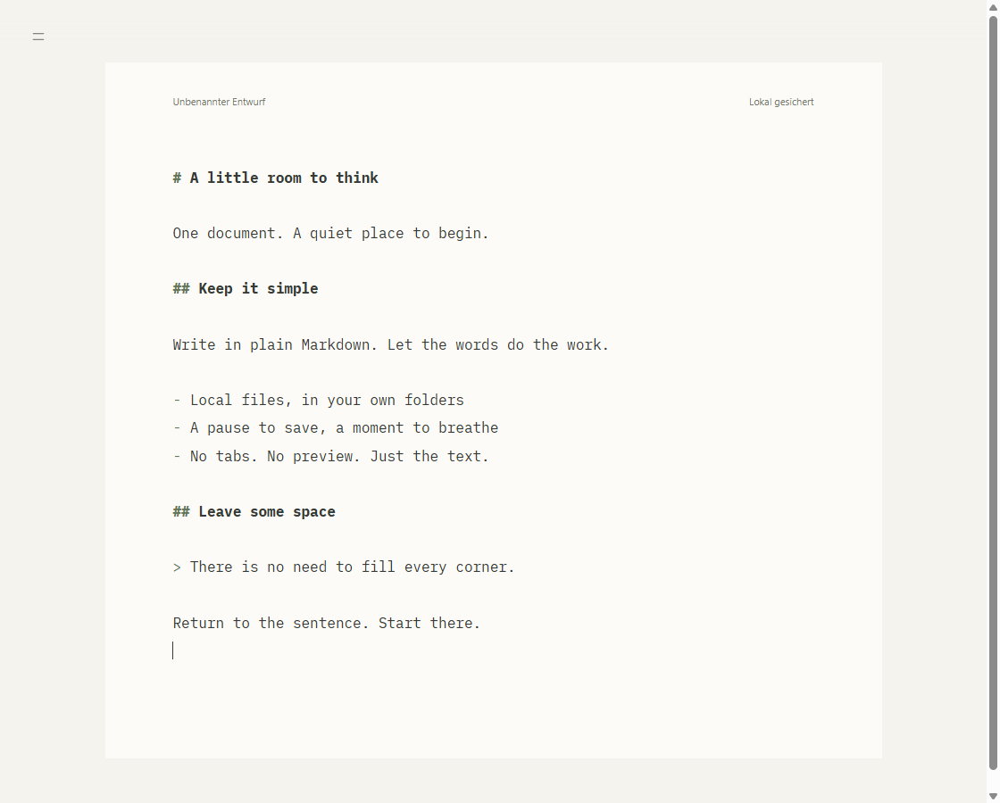
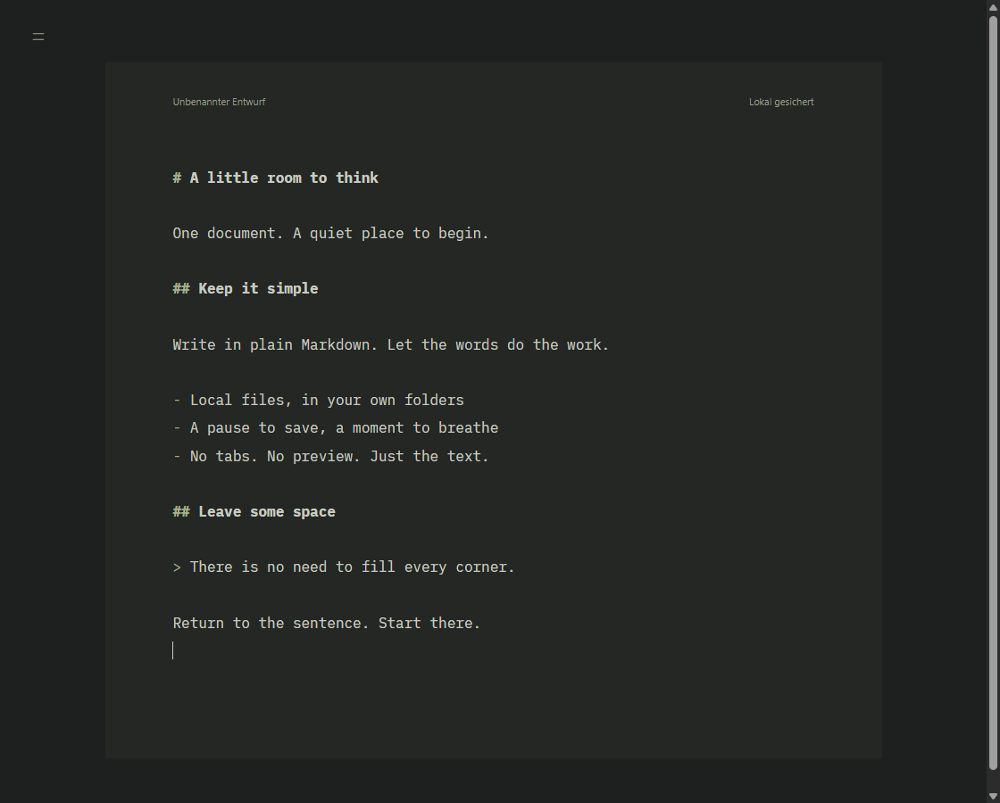

# md0

A quiet, local Markdown editor. Just the source, a little space, and your words.



No tabs, file tree, rendered preview, accounts, or cloud service. Built with Electron and CodeMirror 6, with warm ivory and muted sage colors, a local monospace font, and an OS-following dark mode.

## What it does

- **Start writing immediately.** Unnamed drafts are protected locally and restored on restart.
- **Edit ordinary Markdown files.** Open from Explorer, drag in a file, or use the file picker. Each document has its own window.
- **Autosave after a pause.** Existing files save after 1.5 seconds without typing; `Ctrl+S` saves immediately.
- **Handle outside edits carefully.** Clean documents reload; conflicting edits pause autosave and offer explicit recovery choices.
- **Find your place.** Literal, case-insensitive search and a quick H1/H2 chapter index.
- **Stay in the text.** Fullscreen zen mode, visible Markdown syntax, and deliberate `Ctrl+click` web links.

The current interface is in **German**. Windows x64 is the initial supported distribution target; macOS and Linux are not packaged or verified.

<details>
<summary>Dark mode</summary>



</details>

## Install on Windows

When a release has been published, download `md0-Setup-<version>.exe` from the [Releases page](https://github.com/thomas-sievering/md0/releases). There is no published download yet; to create an installer yourself, see [Build an installer](#build-an-installer).

Run the installer. It installs for your Windows user account, without administrator rights, under `%LOCALAPPDATA%\Programs\md0` and adds a Start menu shortcut.

**The installer is currently unsigned.** Windows may show a security warning. Only run an installer from a source you trust. There is no automatic updater; install a newer release manually.

### Make md0 the default for Markdown

1. Open **Windows Settings → Apps → Default apps**.
2. Search for **`.md`**.
3. Select **md0** and confirm **Set default**.

The installer also registers `.markdown` and `.mdown`; select md0 for those separately if wanted. It does not register itself as the default for `.txt` files, although the editor can open them.

If md0 is missing from the list, choose **Choose an app on your PC** and browse to `%LOCALAPPDATA%\Programs\md0\md0.exe`.

Uninstall through **Settings → Apps → Installed apps**. Local drafts and recovery records may remain in your user profile; do not rely on uninstalling to erase them.

## Shortcuts

| Action | Shortcut |
| --- | --- |
| New document | `Ctrl+N` |
| Open a file | `Ctrl+O` |
| Save / choose a filename for a draft | `Ctrl+S` |
| Search | `Ctrl+F` |
| Next / previous search match | `Enter` / `Shift+Enter` in search |
| Show chapter index temporarily | Hold `Alt` |
| Choose a chapter | Arrow keys, then `Enter` |
| Toggle zen mode | `F11` |
| Open a web link in your browser | `Ctrl+click` |

The upper-left menu exposes the same document actions, recent files, and backup restoration. `Escape` dismisses search or the chapter index, and exits zen mode.

## Your files and local data

Documents stay where you put them. md0 has no cloud sync, analytics, or remote fonts. Web links open in your system browser only when deliberately activated.

Local drafts, conflict backups, and recent-file paths are stored in Electron's user-data directory (normally `%APPDATA%\md0` on Windows). They are **not encrypted**. An older `zen-markdown` profile is reused if one exists and no md0 profile exists.

Files must be valid UTF-8. Existing line endings, BOM, frontmatter, and unrelated whitespace are preserved. Autosave is **not a backup system or a guarantee against simultaneous writers**: keep independent backups of important work. Detected conflicts stop automatic saving rather than silently overwriting the other version.

For recovery behavior, concurrency limits, architecture, and detailed test coverage, see [Engineering notes](docs/engineering.md).

## Develop

Use **Node.js 22.12+** (tested locally with Node 24), npm, and Windows for the supported desktop workflow.

```sh
npm ci
npm start
```

Electron downloads its runtime during installation. If npm asks you to approve dependency install scripts, review and allow the required Electron/esbuild scripts. No development web server is needed.

If your host sets `ELECTRON_RUN_AS_NODE`, clear it before launching the app. In PowerShell:

```powershell
Remove-Item Env:ELECTRON_RUN_AS_NODE -ErrorAction SilentlyContinue
npm start
```

### Checks

```sh
npm run typecheck
npm test
```

`npm test` runs the unit tests and then real Electron E2E tests with isolated temporary profiles. Run it in a Windows desktop session. CI runs the same checks on Windows and builds the installer as an artifact.

### Build an installer

```sh
npm run dist:win
```

Output: `dist/md0-Setup-<version>.exe`. Build outputs and dependencies are not committed. To reproduce the README screenshots with sample text, run `npm run screenshots`.

See [Contributing](CONTRIBUTING.md) for development guidelines, [Third-party notices](THIRD_PARTY_NOTICES.md) for bundled components, and the [release checklist](docs/releasing.md) for publication steps.

## Project status and licensing

md0 is early software. Large-file tuning, cross-platform releases, code signing, localization, and automatic updates are not included in this version.

md0 is licensed under the [MIT License](LICENSE), copyright © 2026 Thomas Sievering. Third-party components retain their respective licenses, including the bundled fonts' [SIL Open Font License](assets/fonts/LICENSE.md).

For security issues, see the [security policy](SECURITY.md); please do not disclose vulnerabilities in public issues.
